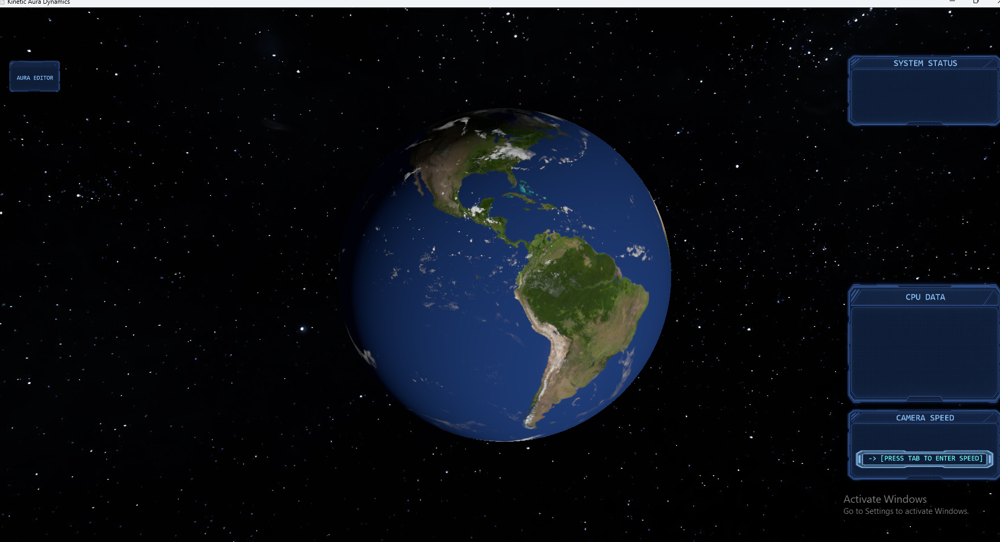

# AuraDynamicsEngine

**Kinetic Aura Dynamics**

AuraDynamicsEngine is a custom C++/DirectX 11 engine I've been building to get deeper into graphics programming and engine development. I use Unreal as well, but I wanted a project where I had to work directly with the rendering pipeline, shaders, input, cameras, resources, and the systems connecting everything instead of having most of that handled for me.

This repo is a working checkpoint, not a finished engine. The engine itself is the main project here. It also includes the current AuraPlatform foundation that the engine has started using while I work toward a more reusable architecture.

## Current Features

- DirectX 11 rendering
- Procedurally generated sphere geometry
- Custom HLSL shaders
- Earth lighting based on the Sun's actual world position
- Normal mapping, ocean specular, night lights, and animated clouds
- Textured Sun rendering
- Star and Milky Way background
- Earth orbit and rotation
- Free-flight camera
- Moving-target Earth focus and tracking
- Custom keyboard and mouse input
- Custom HUD panels and controls
- Early runtime editor/launcher
- Structured diagnostics through AuraPlatform

## Rendering

`SphereMesh` handles reusable sphere geometry and the common rendering work needed by spherical objects. Earth, Sun, and Space build their own behavior around it instead of pushing planet-specific material logic into the mesh itself.

Earth currently uses five texture inputs: day color, ocean/specular, night lights, normal mapping, and clouds. The shader uses the Sun's world-space position to determine which side of Earth is actually facing the light.

The geometric normal controls the large-scale day/night split. The normal map adds the smaller surface lighting detail without changing which hemisphere is actually facing the Sun.

Earth also has its own rotation, while `PlanetOrbit` handles its movement around the Sun.

## Camera

The camera currently has three modes: free flight, returning to focus, and tracking focus.

Free flight is the normal keyboard and mouse camera.

The focus system is a little different because Earth is moving while the camera is trying to reach it. During the return, the camera first inherits Earth's frame-to-frame movement and then closes the remaining distance relative to Earth. Once it reaches the target position, tracking mode keeps it attached to the moving Earth instead of continuously chasing where Earth used to be.

### Controls

| Input | Action |
|---|---|
| `W A S D` | Camera movement |
| `Q / E` | Vertical movement |
| `Left Mouse + Move` | Camera look |
| `1` | Free-flight mode |
| `2` | Focus on Earth |
| `Tab` | Camera speed controls |

## HUD / Editor

The current HUD is my custom panel system. It handles reusable panel windows, buttons, text, images, mouse interaction, minimize/restore behavior, and the specialized panels built on top of it.

The current build has Camera Speed, CPU Data, System Status, and a small Aura Editor entry panel. Aura Editor opens the larger Editor Launcher, which is where I've started experimenting with runtime authoring tools.

This HUD works, but it isn't the UI architecture I want to keep extending forever. I'm keeping the working system stable while I build the newer runtime architecture alongside it.

### Known Limitation

Aggressive window resizing can cause some of the independently anchored HUD panels to overlap.

I experimented with centralized overlap handling, but it ended up making the existing HUD worse by hiding panels and introducing bad resize behavior. I rolled that work back rather than keeping a system I didn't trust.

Since the current HUD is eventually being replaced, I'd rather solve that problem properly in the newer architecture than keep stacking temporary fixes onto the old one.

Normal use at the intended window sizes is unaffected.

## AuraPlatform

AuraDynamicsEngine started purely as an engine project, but over time I've also started building a reusable foundation called `AuraPlatform`.

The engine is still the main application. AuraPlatform is the newer side of the project where I'm working on common systems that shouldn't belong specifically to rendering, UI, or one application.

The current foundation includes work around:

- `AuraID` for shared identity
- common error/result handling
- command definitions and registration
- capability-based authorization
- structured diagnostics
- basic version contracts
- automated tests around the implemented platform behavior

The engine already uses part of this foundation for diagnostics.

There is a much larger direction I want to take AuraPlatform in, but I'm deliberately not presenting that roadmap as finished software. The code in this repository represents the part that actually exists today.

## Where It's Going

Long term, I want Kinetic Aura Dynamics to grow beyond one engine.

The idea is to build software and technical systems that can share well-defined contracts instead of every new application becoming its own disconnected architecture.

`AuraID` is one early part of that idea. Different systems can use the same identity primitive while the system that owns an ID still decides what that identity actually means.

Identity by itself doesn't make separate systems compatible. Real compatibility also needs clear contracts around things like versioning, authorization, data formats, behavior, ownership, lifetime, and communication between systems.

That's the direction I'm working toward, not something I'm claiming is already complete.

## Building

AuraDynamicsEngine is currently developed on Windows using C++, DirectX 11, HLSL, Win32, DirectXMath, and DirectX Tool Kit components.

I'm preparing the repository for a clean build outside my normal development directory. Exact fresh-clone build instructions will replace this section once I've verified the complete setup from a separate clone.

## Third-Party Work

The engine uses third-party libraries and external visual assets. I don't present those as my own work.

DirectX Tool Kit is included as a third-party dependency, and the repository retains its original license information. DirectXMath and other external dependencies/assets remain subject to their respective licenses and usage terms.

I'm checking the redistribution requirements for the external rendering assets before making the repository public.

See `THIRD_PARTY_NOTICES.md` for the current dependency information.

## Development Process

I use AI-assisted tools, including Microsoft Copilot, while working on AuraDynamicsEngine. I mainly use them for debugging, researching unfamiliar areas, reviewing code, and pressure-testing or refactoring ideas.

I don't treat generated code as automatically correct. I decide how the systems fit together, integrate and test changes, trace problems when something breaks, and roll changes back when they make the engine worse. I only want code in this project that I can follow and explain myself.

A big reason I'm building the engine is to get better at reasoning through C++, graphics programming, ownership, data flow, and architecture instead of only getting something working.

## About the Project

AuraDynamicsEngine has changed a lot as I've gotten better at C++ and graphics programming.

I've rewritten systems after understanding their responsibility better, moved code when I realized it was living in the wrong layer, and learned that adding another abstraction doesn't automatically make a design better.

Kinetic Aura Dynamics is the larger direction I'm building toward. AuraDynamicsEngine is the working engine that started it, while AuraPlatform is the beginning of the shared foundation I want future systems to build on.

I'm not presenting AuraDynamicsEngine as a finished commercial engine or AuraPlatform as a finished universal platform. This repository is a snapshot of what I actually have working today and the engineering direction I'm taking from here.

## License

AuraDynamicsEngine is currently published as a portfolio and development project.

Unless a file or third-party component states otherwise, I'm not currently granting general permission to copy, redistribute, modify, or use my original AuraDynamicsEngine source in another project.

Third-party libraries and assets remain covered by their own licenses and usage terms.

I may choose a formal software license later as AuraDynamicsEngine and the larger Kinetic Aura Dynamics project develop.