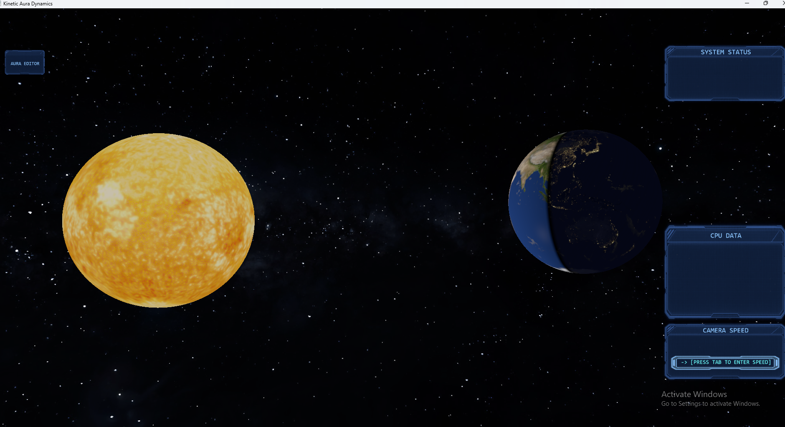
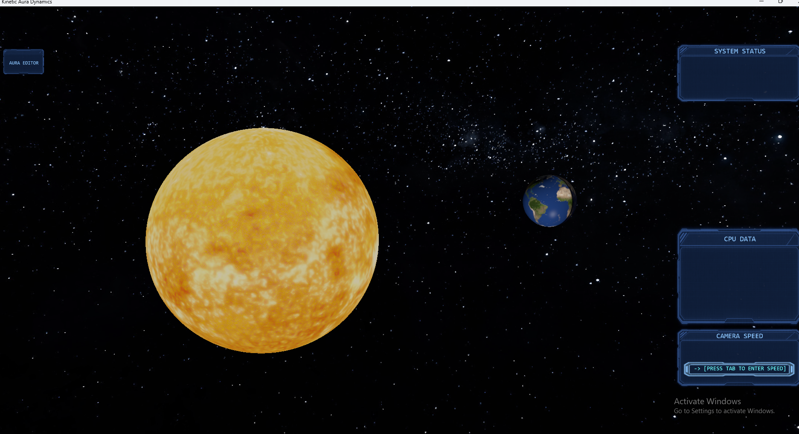

# AuraDynamicsEngine

**Kinetic Aura Dynamics**

AuraDynamicsEngine is a custom C++/DirectX 11 engine I've been building to get deeper into graphics programming and engine development.

I use Unreal as well, but I wanted a project where I had to work directly with the rendering pipeline, shaders, resources, input, cameras, and the systems connecting everything instead of having most of that handled for me.

This repository is a working checkpoint of the engine, not a finished product. The engine is the main project here, along with the part of AuraPlatform it currently depends on as I start moving toward a more reusable architecture.

## What Currently Works

- DirectX 11 rendering
- Procedurally generated sphere geometry
- Custom HLSL shaders
- Earth lighting based on the Sun's world position
- Normal mapping
- Ocean specular response
- Night-side city lights/emission
- Animated clouds
- Textured Sun rendering
- Star and Milky Way background
- Earth orbit and rotation
- Free-flight camera
- Moving-target Earth focus and tracking
- Custom keyboard and mouse input
- Custom HUD panels and controls
- Early runtime editor/launcher
- Structured diagnostics through AuraPlatform

## Rendering

`SphereMesh` handles the reusable sphere geometry and common rendering work needed by spherical objects. Earth, Sun, and Space build their own behavior around it instead of putting planet-specific material logic into the mesh itself.

Earth currently uses five texture inputs: day color, ocean/specular, night lights, normal mapping, and clouds. The shader uses the Sun's world-space position to determine which side of Earth is actually facing the light.

One part that took some work to get right was keeping the large-scale day/night lighting separate from the smaller surface detail. The geometric normal determines which hemisphere is facing the Sun, while the normal-mapped surface normal adds local detail without being allowed to move the night side onto the lit hemisphere.

Earth rotates independently while `PlanetOrbit` handles its movement around the Sun.

### Scene Overview

This view pulls farther back and shows more of the engine running at once: the Sun, Earth, space background, and the current HUD over the scene.

## Camera

The camera currently has three modes:

- **FreeFlight**
- **ReturningFocus**
- **TrackingFocus**

Free flight is the normal keyboard and mouse camera.

The focus system had to account for the fact that Earth doesn't stop moving just because the camera is trying to return to it. During the return, the camera first inherits Earth's frame-to-frame movement and then closes the remaining distance relative to Earth.

Once it reaches the target position, tracking keeps that relationship while Earth continues moving. This also lets me leave Earth from one viewing angle, move around in free flight, and return without always snapping back to one hard-coded camera position.

### Controls

| Input | Action |
|---|---|
| `W A S D` | Camera movement |
| `Q / E` | Vertical movement |
| `Left Mouse + Move` | Camera look |
| `1` | Free-flight mode |
| `2` | Focus on Earth |
| `Tab` | Camera speed controls |

## HUD / Editor

The current HUD is my custom panel system. It handles reusable panel windows, buttons, text, images, mouse interaction, minimize/restore behavior, and the specialized panels built on top of it.

The current build includes:

- Camera Speed
- CPU Data
- System Status
- Aura Editor entry panel

Aura Editor opens the larger Editor Launcher, which is where I've started working on runtime authoring tools.

The current HUD works, but it isn't the UI architecture I want to keep extending forever. I'm keeping the working system stable while I build the newer runtime architecture alongside it.

## Engine Demos

I recorded two short demos to show the engine actually running instead of trying to cover everything with screenshots.

### Camera Movement / Focus Demo

[Watch the Camera Movement / Focus Demo](docs/recordings/CameraMovementDemo.mp4)

This one focuses more on moving around Earth and the camera behavior. It shows the camera leaving the target, moving through the scene, and returning to the moving Earth while keeping its target-relative position rather than always returning to the same fixed viewpoint.

### Earth / Sun Demo

[Watch the Earth / Sun Demo](docs/recordings/Earth-SunDemo.mp4)

This recording gives a wider look at Earth and the Sun from different positions and viewing angles. It also gives a better view of how Earth's lighting and appearance change relative to the Sun.

> **Recording note:** The screen capture came out choppier than the engine looks while I'm actually running it. Some movement in these videos can look like engine stutter because of the recording quality, while normal runtime rendering is smooth.

## Known Limitation

Aggressive window resizing can cause some independently anchored HUD panels to overlap.

I experimented with centralized overlap handling, but it ended up making the existing HUD worse by hiding panels and causing bad resize behavior. I rolled that work back instead of keeping a layout system I didn't trust.

Since this HUD architecture is eventually being replaced, I'd rather solve cross-panel layout properly in the newer system than keep stacking temporary fixes onto the old one.

Normal use at the intended window sizes is unaffected.

## AuraPlatform

AuraDynamicsEngine started purely as an engine project, but over time I've also started building a reusable foundation called `AuraPlatform`.

The engine is still the main application. AuraPlatform is the newer side of the project where I'm moving things that make more sense as shared Aura systems instead of something owned specifically by rendering, UI, or one application.

The current foundation includes:

- `AuraID` for shared identity
- common error/result handling
- command definitions and registration
- capability-based authorization
- structured diagnostics
- basic version contracts
- automated tests around the platform behavior that's currently implemented

The engine already uses the diagnostics part of this foundation.

I have a much larger direction in mind for AuraPlatform, but I'm not treating plans as finished architecture. What is in this repository is the part I've actually implemented so far.

## Where It's Going

Long term, I want Kinetic Aura Dynamics to grow beyond one engine.

I want to be able to build different applications and technical systems without every new project becoming its own disconnected architecture. The goal behind AuraPlatform is to gradually establish shared contracts that those systems can build on.

`AuraID` is one early piece of that. Different systems can use the same identity primitive without `AuraID` itself needing to understand what it's identifying.

Shared identity isn't enough to make separate systems compatible on its own. That will also require clear contracts around versioning, authorization, data formats, behavior, ownership, lifetime, and how the systems communicate.

That's where I want to take it over time. It isn't something I'm claiming is already finished.

## Building

AuraDynamicsEngine is currently developed on Windows using:

- C++
- DirectX 11
- HLSL
- Win32
- DirectXMath
- DirectX Tool Kit

This repository is a development and portfolio checkpoint of the engine. The source and project structure are included for technical review, but I'm not presenting this release as a packaged or supported engine distribution.
## Tests

`AuraDynamicsEngine.Tests` uses Google Test against the production AuraPlatform implementation.

The current tests cover:

- capability identity
- command registration and lookup
- authorized command dispatch
- unauthorized command dispatch
- missing command handling
- diagnostic event state
- diagnostic error storage
- diagnostic routing through the file sink

I'm using the tests to prove behavior that actually exists rather than filling the project with tests for systems that are still only planned.

## Third-Party Work

The engine uses third-party libraries and external visual assets. I don't present those as my own work.

DirectX Tool Kit is included as a third-party dependency, and its original license information is kept with the vendored source.

DirectXMath and other external dependencies and assets remain covered by their own licenses and usage terms.

See `THIRD_PARTY_NOTICES.md` for the current dependency information.

## Development Process

I use AI-assisted tools, including Microsoft Copilot, while working on AuraDynamicsEngine. I mainly use them for debugging, researching things I haven't worked with before, reviewing code, and pressure-testing or refactoring ideas.

I don't assume generated code is correct just because it compiles or looks cleaner. I decide how the systems fit together, integrate the changes, build and run the engine, trace problems when something breaks, and roll back changes when they make the project worse.

I only want code in the project that I can follow and explain myself.

A big reason I'm building this engine is to keep getting better at reasoning through C++, graphics programming, ownership, data flow, and architecture instead of only getting something working.

## About the Project

AuraDynamicsEngine has changed a lot as I've gotten better at C++ and graphics programming.

I've rewritten systems after understanding their responsibility better, moved code after realizing it was living in the wrong layer, and learned that adding another abstraction doesn't automatically make a design better.

Kinetic Aura Dynamics is the bigger direction I'm building toward. AuraDynamicsEngine is the working engine that started it, while AuraPlatform is the beginning of the shared foundation I want future systems to build on.

I'm not presenting AuraDynamicsEngine as a finished commercial engine or AuraPlatform as a finished universal platform. This repository is a snapshot of what I actually have working today and where I'm taking the engineering from here.

## License

AuraDynamicsEngine is currently published as a portfolio and development project.

Unless a file or third-party component states otherwise, I'm not currently granting general permission to copy, redistribute, modify, or use my original AuraDynamicsEngine source in another project.

Third-party libraries and assets remain covered by their own licenses and usage terms.

I may choose a formal software license later as AuraDynamicsEngine and the larger Kinetic Aura Dynamics project develop.